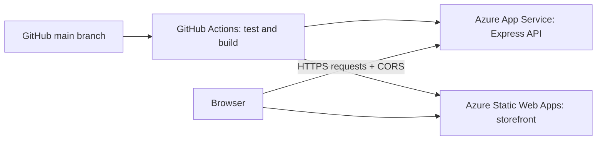

# Thread & Form — clothing store deployment practice

A working clothing storefront with a separate Node.js API. Run both locally, push this folder to its own GitHub repository, then practise deploying with GitHub Actions to **Azure Static Web Apps** (frontend) and **Azure App Service / Web App** (backend).

**No Docker, Kubernetes, database, or Azure account is needed to run locally.** Azure hosting is a later step. This project has not been deployed for you.

## What you can try

- Browse eight illustrated products, filter categories, search, and sort.
- Select sizes, add/remove pieces, and adjust quantities in a shopping bag saved in your browser.
- Submit a demo checkout to the API. Prices and delivery are calculated by the server.
- Practise builds, API tests, secrets, environment variables, CORS, deployment, logs, and rollback.

Checkout takes no payment or customer details. Orders receive a demo reference and are **not saved or fulfilled**. This is a deployment exercise, not a production commerce system.

## Folder layout

```text
cloth-store-deployment/       <-- Use THIS folder as your new GitHub repository root
├── frontend/
│   ├── src/                 # Plain JavaScript + CSS; built with Vite
│   ├── public/              # Local SVG illustrations + Azure static hosting config
│   ├── index.html
│   ├── .env.example
│   ├── package.json
│   └── package-lock.json
├── backend/
│   ├── src/                 # Express server, catalog, checkout validation
│   ├── test/                # API integration tests using Node's test runner
│   ├── .env.example
│   ├── package.json
│   └── package-lock.json
├── .github/workflows/ci-cd.yml
├── .gitignore
├── .nvmrc
└── README.md
```



The browser calls the API's separate HTTPS address directly. This exercise does not use integrated Azure Functions or a linked `/api` proxy.

## 1. Run locally on Windows

Install **Node.js 24 LTS** and **Git**. Check `node --version`, `npm --version`, and `git --version` in a new terminal. The project also supports Node 22.12+, but the included Azure workflow uses Node 24. No global npm packages are required.

Open this folder in VS Code. Use two PowerShell terminals.

**Terminal 1 — backend:**

```powershell
# From cloth-store-deployment
cd backend
Copy-Item .env.example .env
npm ci
npm run dev
```

**Terminal 2 — frontend:**

```powershell
# From cloth-store-deployment in a NEW terminal
cd frontend
Copy-Item .env.example .env
npm ci
npm run dev
```

Open **http://localhost:5173**. Use that exact hostname; `127.0.0.1` is a different browser origin. The backend health endpoint is **http://localhost:3001/api/health**.

You only need to copy environment files once. On later runs, use `npm run dev` in each directory. Stop each process with **Ctrl+C**. If PowerShell blocks `npm.ps1`, use `npm.cmd` instead of `npm` in these commands.

### Local configuration

| File | Variable | Default / purpose |
| --- | --- | --- |
| `frontend/.env` | `VITE_API_URL` | `http://localhost:3001` — API origin, without `/api` |
| `backend/.env` | `PORT` | `3001` |
| `backend/.env` | `NODE_ENV` | `development` locally |
| `backend/.env` | `CORS_ORIGINS` | `http://localhost:5173,http://localhost:4173` |

Restart the appropriate dev process after changing `.env`. `.env` files are ignored by Git. All `VITE_` values are public browser configuration; never put passwords or deployment tokens in them.

### Verify the app

1. See products load, filter to Shirts, search for Linen, and change sort order.
2. Add a size M shirt twice. Open Bag and check the quantity, delivery, and total.
3. Refresh and confirm the bag remains. Try demo checkout and see the reference.
4. Stop the API and reload. The storefront should show a useful error and retry button.

Run API tests from `backend`:

```powershell
npm test
```

Build and preview the frontend from `frontend`:

```powershell
npm run build
npm run preview
```

Open **http://localhost:4173** with the backend running. The output in `frontend/dist` is what Static Web Apps will serve. `vite preview` is for local verification only; Azure serves the built static files.

## 2. Push this folder to GitHub

Because this folder was generated inside an existing project, **copy the whole `cloth-store-deployment` folder to a separate location first**, including `.github`, `.gitignore`, and `.nvmrc`. Open the copied folder in VS Code. This makes the frontend, backend, and workflow sit at the new repository root.

Create an empty GitHub repository called `cloth-store-deployment` (do not initialize it with a README). From the copied folder:

```powershell
git init
git add .
git commit -m "Add clothing store deployment practice project"
git branch -M main
git remote add origin https://github.com/YOUR-USERNAME/cloth-store-deployment.git
git push -u origin main
```

Replace `YOUR-USERNAME`. `node_modules`, build output, and `.env` stay out of Git; commit both lockfiles. In GitHub Actions, the API tests and frontend build should pass. Azure deployment jobs are intentionally skipped until you configure the resources and set `DEPLOY_TO_AZURE=true`.

## 3. Create Azure resources in the portal

Use an Azure subscription where you can create resources and role assignments. Put the practice resources into one new resource group, for example `rg-cloth-store-practice`, so cleanup is straightforward. Review the portal's estimated charges when choosing plans.

### Backend: Web App / App Service

Create a **Web App** with **Code** publishing, **Linux**, and **Node 24 LTS**. Choose an available practice plan for your subscription. Leave automatic continuous deployment off; this repository already supplies its workflow. Keep HTTPS enabled.

In the Web App's configuration, set **Startup Command** to `npm start`. Under **Environment variables / App settings**, add:

| Setting | Value |
| --- | --- |
| `NODE_ENV` | `production` |
| `CORS_ORIGINS` | The exact frontend HTTPS origin; fill this after creating the Static Web App |
| `SCM_DO_BUILD_DURING_DEPLOYMENT` | `false` |

The workflow packages dependencies on Linux, so App Service does not need to rebuild. The code reads Azure's supplied `PORT`; do not hardcode port 3001 in Azure. Save settings and restart after editing. Reference: [Node.js on App Service](https://learn.microsoft.com/en-us/azure/app-service/configure-language-nodejs).

Copy the **Default domain** shown on the Web App Overview and prefix it with `https://`. Use the actual displayed domain, including any generated suffix. Call this your **backend origin**.

### Frontend: Static Web App

Create a **Static Web App**, choose the Free hosting plan for the exercise if available, and select **Other** as the deployment source so the portal does not create a duplicate GitHub workflow. This project needs static hosting only.

Copy its generated HTTPS URL and set that exact value as the backend's `CORS_ORIGINS`. No trailing slash, URL path, or wildcard. If you also want the local frontend to call Azure, add `http://localhost:5173` separated by a comma. The API handles CORS itself; leave App Service's separate CORS list empty to avoid conflicting policies.

Open **Manage deployment token** in the Static Web App and keep the token for the GitHub secret in the next step. See [Static Web Apps deployment configuration](https://learn.microsoft.com/en-us/azure/static-web-apps/build-configuration).

## 4. Configure GitHub → Azure authentication

The backend workflow uses **OpenID Connect (OIDC)** with a user-assigned managed identity. No client password or publish profile is needed.

In Azure Portal:

1. Create a **User Assigned Managed Identity** in the practice resource group. Copy its **Client ID** and **Tenant ID**; copy your **Subscription ID** too.
2. Open the identity's **Federated credentials** and add the GitHub Actions scenario. Enter your exact GitHub owner and repository; choose **Branch** and enter **main**. The subject must be `repo:YOUR-USERNAME/cloth-store-deployment:ref:refs/heads/main`, with issuer `https://token.actions.githubusercontent.com` and audience `api://AzureADTokenExchange`.
3. Open the **Web App → Access control (IAM)**. Assign **Website Contributor** to that managed identity at this Web App's scope. Role assignment requires suitable access in your subscription; an administrator may need to do it.

The job uses branch federation and does not specify a GitHub Environment. Reference: [Azure Login with OIDC](https://learn.microsoft.com/en-us/azure/developer/github/connect-from-azure-openid-connect).

In **GitHub repository → Settings → Secrets and variables → Actions**, add these **repository secrets**:

| Secret name | Value |
| --- | --- |
| `AZURE_CLIENT_ID` | Managed identity Client ID |
| `AZURE_TENANT_ID` | Directory/Tenant ID |
| `AZURE_SUBSCRIPTION_ID` | Subscription ID |
| `AZURE_STATIC_WEB_APPS_API_TOKEN` | Static Web App deployment token |

On the **Variables** tab, add these **repository variables**:

| Variable name | Value |
| --- | --- |
| `AZURE_WEBAPP_NAME` | Web App resource name, not its URL |
| `VITE_API_URL` | Exact backend origin, e.g. `https://YOUR-ACTUAL-BACKEND-DOMAIN` |
| `DEPLOY_TO_AZURE` | `true` — add last, once all settings are ready |

`VITE_API_URL` must start with `https://` and have no trailing slash or `/api` suffix. It is built into the frontend bundle at build time. Changing it requires another workflow run; Static Web App server settings do not rewrite an existing JavaScript bundle.

## 5. First live deployment

In **GitHub → Actions → Test and deploy clothing store**, select **Run workflow** on branch **main**.

The workflow:

1. Installs locked dependencies, tests the API, and builds the storefront.
2. Deploys the backend package to App Service and checks `/api/health`.
3. Uploads the built frontend to Static Web Apps. The deployment action skips its own app build because Vite already built the files.

Subsequent pushes to `main` repeat this process. Pull requests only run checks. If either check fails, deployment stops. See [App Service GitHub Actions deployment](https://learn.microsoft.com/en-us/azure/app-service/deploy-github-actions?tabs=openid).

Verify in the browser:

- `BACKEND-ORIGIN/api/health` returns JSON with `"status":"ok"`.
- Open the Static Web App URL and see the products.
- Browser developer tools → Network shows `/api/products` requests going to the backend's HTTPS URL.
- Add an item and submit a demo checkout. `/api/orders` returns HTTP 201.

You now have a live practice storefront and API on Azure's production endpoints. Real selling would additionally need persistent storage, payment processing, authentication where appropriate, inventory, monitoring, and other operational work.

## API reference

| Method | Path | Result |
| --- | --- | --- |
| GET | `/api/health` | Health, service name, and version |
| GET | `/api/products` | Products, categories, and delivery rules |
| GET | `/api/products/:id` | One product or HTTP 404 |
| POST | `/api/orders` | Validates bag and returns a stateless demo confirmation |

Example request body:

```json
{
  "items": [
    { "productId": "linen-shirt", "size": "M", "quantity": 1 }
  ]
}
```

API prices/totals use **integer paise** (`189900` means ₹1,899). Delivery is ₹99 below ₹3,000 and complimentary at or above ₹3,000. No tax calculation is implemented. Submitted prices are ignored. Quantities must be integers from 1 to 10, and repeated product/size rows are rejected. CORS is a browser rule, not authentication; these demo endpoints are public.

## Deployment practice exercises

1. Change the homepage heading, commit, and push. Watch Actions update the live storefront.
2. Change a product price in `backend/src/catalog.js`. Update any affected assertions in the tests, then push and confirm the new live price.
3. Make an intentional API test failure on a practice branch and open a pull request. Watch checks fail, then fix it before merging.
4. Change `VITE_API_URL`, run the workflow again, and observe where the browser sends its requests.
5. View **App Service → Monitoring → Log stream**; enable filesystem application logging if needed. Set the App Service health check path to `/api/health` if supported by your plan.
6. Practise rollback with `git revert COMMIT-SHA` and push the revert. Do this in your practice repository.

## Troubleshooting

| Symptom | Check |
| --- | --- |
| Local page loads but no products | Start the API; open its health URL; check frontend `.env`, hostname, and backend CORS list. |
| Port already in use | Stop the other dev process. If changing ports, update the frontend API URL or allowed frontend origin accordingly. |
| npm reports `SELF_SIGNED_CERT_IN_CHAIN` on a corporate network | With a current Node 24 installation, run `$env:NODE_USE_SYSTEM_CA='1'` in PowerShell, then retry `npm ci`. This uses the Windows trust store; your organization certificate must be installed there. Keep TLS verification enabled. |
| Azure deployment is skipped | Set the repository **variable** `DEPLOY_TO_AZURE` to `true`, run on `main`, and avoid the pull request trigger. |
| Azure login fails | Compare exact federation owner/repository/branch, the managed identity Client ID, tenant, subscription, and Website Contributor assignment. |
| Backend startup fails / HTTP 503 | Check Node 24 Linux runtime, `npm start`, required production `CORS_ORIGINS`, and Log stream. The zip must have `package.json` at its root. |
| Live API returns 403 / CORS error | Match backend `CORS_ORIGINS` to the exact browser origin, with no trailing slash, and restart the backend after saving. |
| Browser calls localhost after deployment | Set repository variable `VITE_API_URL` to the backend HTTPS origin and run the entire workflow again. |
| Static frontend looks old | Confirm a successful deployment, then hard refresh; compare the Git commit in Actions. |
| Workflow not found | `.github/workflows` must be at the new repository root; pushing the parent project with this folder nested will not work. |

## Clean up when finished

Delete **only the dedicated practice resource group** in Azure Portal after confirming it contains just your exercise resources. This removes the Web App, its App Service plan, Static Web App, and managed identity together when they are all in that group. Deleting only the Web App can leave a billable plan behind. Set `DEPLOY_TO_AZURE=false` or remove it in GitHub to stop future deploy attempts, and remove the deployment secrets when no longer needed.
